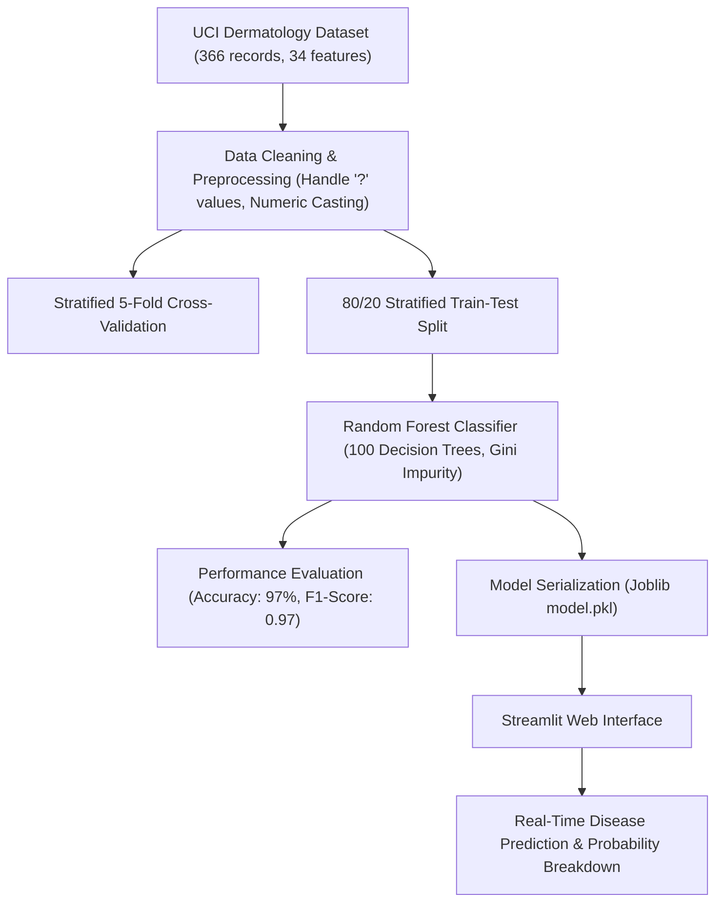

# 🩺 Skin Disease Classification using Machine Learning

[](https://www.python.org/)
[](https://streamlit.io/)
[](https://scikit-learn.org/)
[]()
[](LICENSE)

> An interpretable machine learning system for multi-class classification of six chronic dermatological diseases using clinical and histopathological observations, paired with an interactive, layman-friendly Streamlit web application.

---

## 📌 Table of Contents
- [Overview](#-overview)
- [Target Conditions](#-target-conditions)
- [Key Features](#-key-features)
- [Machine Learning Architecture](#-machine-learning-architecture)
- [Performance & Benchmark Results](#-performance--benchmark-results)
- [Project Structure](#-project-structure)
- [Installation & Setup](#-installation--setup)
- [Running the Application](#-running-the-application)
- [Sample Predictions](#-sample-predictions)
- [Medical Disclaimer](#-medical-disclaimer)
- [Contributors & Mentorship](#-contributors--mentorship)
- [License](#-license)

---

## 🔬 Overview

Skin diseases represent a significant healthcare burden worldwide. Due to overlapping visible presentations (e.g., redness, scaling, itching) among different chronic dermatological conditions, manual clinical differentiation can be challenging, subjective, and prone to misdiagnosis without biopsy analysis.

This project delivers an automated clinical decision support system utilizing the **UCI Dermatology Dataset**. By analyzing **34 distinct features** (clinical symptoms and histopathological indicators), the model accurately differentiates between **six chronic skin conditions** with **~97% test accuracy** and **~96% 5-fold cross-validation accuracy**.

A production-style **Streamlit Web Application** provides non-specialist users and frontline health workers with intuitive, layman-friendly terminology alongside real-time disease probability estimates.

---

## 🏷️ Target Conditions

The classifier distinguishes between 6 primary chronic dermatological conditions:

| Class Code | Condition Name | Description |
|:---:|:---|:---|
| **1** | **Psoriasis** | Autoimmune disease causing rapid skin cell accumulation, plaque scaling, and erythema. |
| **2** | **Seborrheic Dermatitis** | Inflammatory skin condition producing flaky scales on oily zones (scalp, face). |
| **3** | **Lichen Planus** | Chronic swelling with purplish polygonal lesions and oral mucosal involvement. |
| **4** | **Pityriasis Rosea** | Acute rash characterized by a primary herald patch followed by oval secondary eruptions. |
| **5** | **Chronic Dermatitis** | Longstanding eczema causing marked skin thickening (acanthosis) and chronic pruritus. |
| **6** | **Pityriasis Rubra Pilaris** | Rare group of disorders manifesting with orange-red plaques and follicular keratotic papules. |

---

## ✨ Key Features

- **Holistic 34-Feature Input**: Combines 11 patient-observable clinical signs with 22 microscopic histopathological attributes and patient age.
- **Interpretable Decision Forest**: Implemented with `RandomForestClassifier` (100 estimators, Gini criterion) for robust generalization on tabular clinical data.
- **Cross-Validated Reliability**: Evaluated with 5-Fold Stratified Cross Validation to avoid train-test split bias and ensure generalizability.
- **Layman-Friendly Web UI**: Complex medical terms (e.g., *Munro microabscess*, *Fibrosis of papillary dermis*, *Melanin incontinence*) translated into plain English descriptions.
- **Confidence Breakdown**: Interactive dashboard output showing probability distribution across all six classes.

---

## 🏗️ Machine Learning Architecture



### Feature Breakdown:
1. **Clinical Symptoms (11)**: Erythema, Scaling, Definite borders, Itching, Koebner phenomenon, Polygonal papules, Follicular papules, Oral mucosal involvement, Knee/elbow involvement, Scalp involvement, Family history.
2. **Histopathological Attributes (22)**: Melanin incontinence, Eosinophils in infiltrate, PNL infiltrate, Fibrosis of papillary dermis, Exocytosis, Acanthosis, Hyperkeratosis, Parakeratosis, Clubbing of rete ridges, Elongation of rete ridges, Thinning of suprapapillary epidermis, Spongiform pustule, Munro microabscess, Focal hypergranulosis, Disappearance of granular layer, Basal layer damage, Spongiosis, Saw-tooth appearance of rete, Follicular horn plug, Perifollicular parakeratosis, Inflammatory mononuclear infiltrate, Band-like infiltrate.
3. **Demographic (1)**: Patient Age.

---

## 📊 Performance & Benchmark Results

### Model Comparison
| Algorithm | Test Accuracy | Characteristics |
|:---|:---:|:---|
| Logistic Regression | 85.0% | High bias on non-linear histological features |
| Support Vector Machine (SVM) | 91.0% | Effective margin separation, slower calibration |
| **Random Forest (Ours)** | **97.2%** | **Best performance; robust against overfitting and feature colinearities** |

### Detailed Classification Report (Random Forest)
```text
               precision    recall  f1-score   support

    Psoriasis       0.96      1.00      0.98        22
  Seborrheic D.     1.00      0.93      0.96        14
 Lichen Planus      1.00      1.00      1.00        14
Pityriasis R.       0.89      1.00      0.94         8
Chronic Derm.       1.00      1.00      1.00        12
Pityriasis RP       1.00      0.50      0.67         2

     accuracy                           0.97        72
    macro avg       0.97      0.90      0.92        72
 weighted avg       0.97      0.97      0.97        72
```

- **5-Fold Cross Validation Average**: **~96.4%**

---

## 📁 Project Structure

```bash
skin-disease-classification/
├── assets/
│   ├── confusion_matrix.png         # Evaluated confusion matrix heatmap
│   └── feature_importance.png       # Top 15 decisive medical features
├── data/
│   ├── dermatology.csv              # Benchmark dataset (366 samples, 35 columns)
│   └── download_data.py             # Automated script to fetch directly from UCI
├── notebooks/
│   └── Skin_Disease_Classification.ipynb  # Interactive EDA, modeling & evaluation
├── app.py                           # Interactive Streamlit Web Application
├── train.py                         # Standalone ML training and evaluation pipeline
├── requirements.txt                 # Project dependencies
├── .gitignore                       # Standard Python ignore rules
├── LICENSE                          # MIT License
└── README.md                        # Documentation & setup guide
```

---

## ⚙️ Installation & Setup

### Prerequisites
- Python 3.9+ installed on your system.
- Git installed.

### 1. Clone the Repository
```bash
git clone https://github.com/NakkaPrasannaLakshmi/skin-disease-classification.git
cd skin-disease-classification
```

### 2. Create and Activate a Virtual Environment
- **Windows (Command Prompt / PowerShell)**:
  ```bash
  python -m venv venv
  venv\Scripts\activate
  ```
- **macOS / Linux**:
  ```bash
  python3 -m venv venv
  source venv/bin/activate
  ```

### 3. Install Dependencies
```bash
pip install -r requirements.txt
```

---

## 🚀 Running the Application

### Train the Model (Optional - Pre-trained model can be re-generated)
To run the full 5-fold cross-validation pipeline and save the updated `model.pkl`:
```bash
python train.py
```

### Launch the Streamlit Web Application
```bash
streamlit run app.py
```
After executing, the interactive application will open in your browser at `http://localhost:8501`.

---

## 🧪 Sample Predictions

| Patient Case | Key Symptoms | Expected Class | Predicted Disease |
|:---|:---|:---:|:---|
| **Case 1** | Moderate Erythema, Severe Scaling, Scalp involvement, Age 35 | Class 1 | **Psoriasis** |
| **Case 2** | Definite borders, Polygonal Papules, Oral mucosal involvement, Melanin incontinence, Age 50 | Class 3 | **Lichen Planus** |

---

## ⚠️ Medical Disclaimer

This project is an academic research demonstration and supportive diagnostic aid. It is **not** intended to replace certified medical evaluation, laboratory biopsy, or professional dermatological diagnosis. Always consult a qualified medical specialist for clinical concerns.

---

## 👥 Contributors & Mentorship

- **Department:** CSE (AIML & IoT), [Vallurupalli Nageswara Rao Vignana Jyothi Institute of Engineering & Technology (VNR VJIET)](https://vnrvjiet.ac.in/), Hyderabad, India.
- **Student Contributors:**
  - N. Prasanna Lakshmi (`22071A6945`)
  - P. Gayathri (`22071A6948`)
  - R. Harsha Vardhan (`22071A6954`)
  - Sadiya Tehreen (`22071A6955`)
- **Faculty Guide:**
  - **Shaik Mabasha**, Assistant Professor, Dept. of CSE-AIML & IoT, VNR VJIET
- **Head of Department:**
  - **Dr. Sagar Yeruva**, Associate Professor & HoD, Dept. of CSE-AIML & IoT, VNR VJIET

---

## 📄 License

This project is licensed under the [MIT License](LICENSE).
